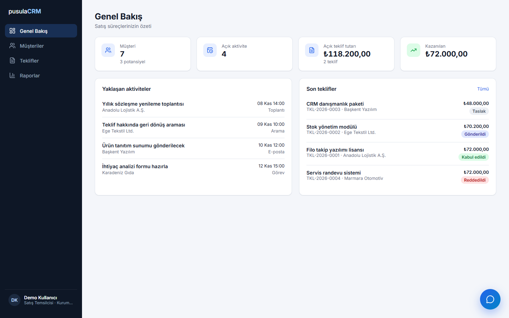
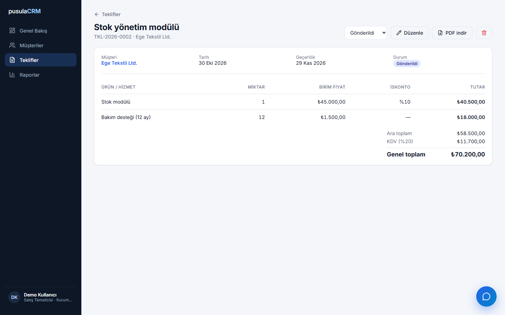
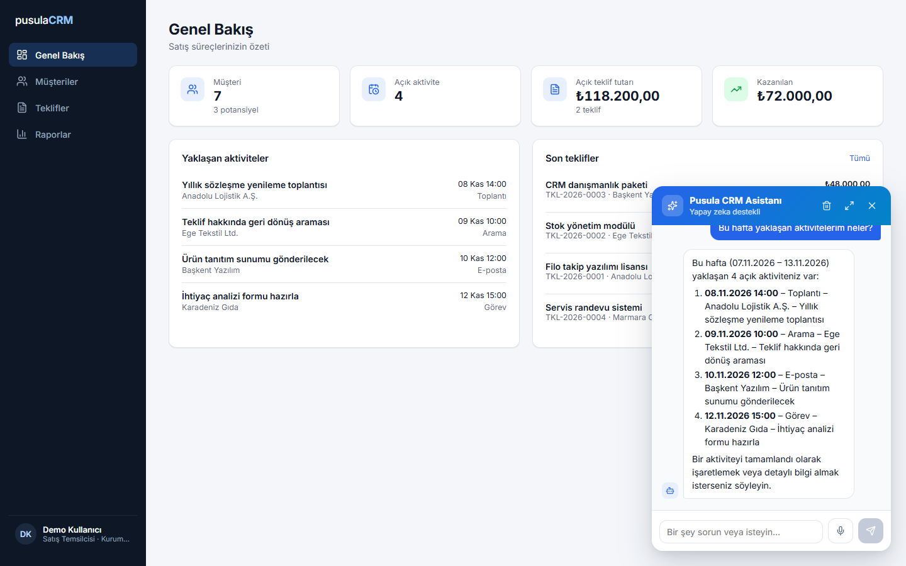

# Pusula CRM — API

Müşteri, aktivite, teklif işleri ve yapay zeka asistanı. 

## Ekran görüntüleri



| Teklif detayı | Asistan |
|---|---|
|  |  |

## Kullandıklarım

- ASP.NET Core 8 Web API
- Entity Framework Core 8 + PostgreSQL
- Asistan için ai api. 
- Testler: xUnit + EF Core memoery

## Çalıştırma

Gerekenler: .NET 8 SDK ve Docker Desktop.

**1. Veritabanı up**

```bash
docker compose up -d
```

dışarıya **5433** portundan açıldı. Bağlantılar appsettings.json da.

**2. API'yi çalıştır**

```bash
dotnet run
```

API `http://localhost:5080`'de açılıyor

Veritabanını sıfırlamak için:

```bash
docker compose down -v   # tüm veriyi siler, sonraki açılışta örnek veriler yeniden yüklenir
```


## Yayın

Railway de Dockerfile ile çalışıyor.

